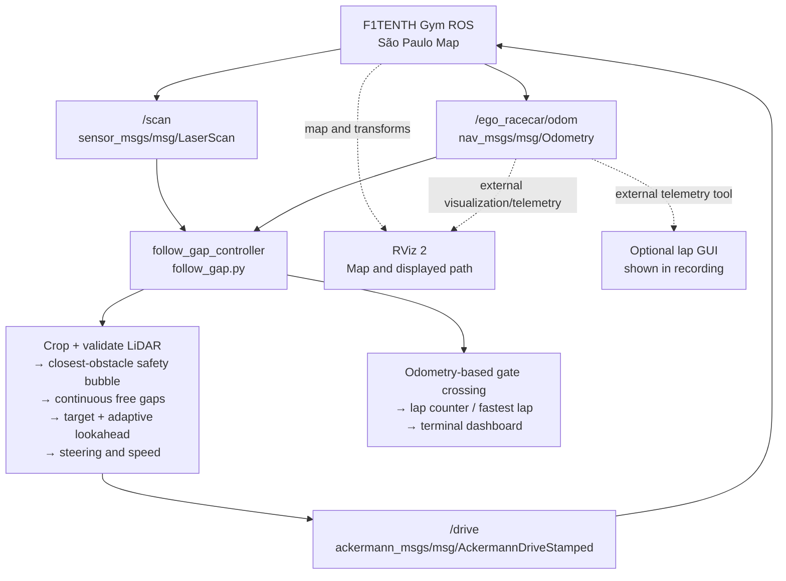

# 🏎️ Reactive Follow-the-Gap (FTG) Controller — São Paulo Circuit (F1TENTH)


- **Author:** *[Add your name]*
- **Course:** Autonomous Vehicles — II PAO 2026
- **Assessment:** First Midterm Project (Part 1) — Reactive Controllers Competition
- **Circuit:** **São Paulo**
- **Platform:** F1TENTH Gym ROS, ROS 2 Humble, Python

A ROS 2 autonomous racing controller that interprets 2D LiDAR data to find navigable gaps, chooses a stable driving target, and publishes steering and speed commands for the F1TENTH vehicle. The supplied controller integrates **adaptive lookahead**, **Pure-Pursuit-style steering**, **speed-aware cornering**, **directional lap counting**, and an **emergency LiDAR watchdog**.


> **Implementation note:** This repository version uses Follow-the-Gap with a geometric safety bubble. It does **not** implement an independent adjacent-beam Disparity Extender routine; the name and algorithm description here follow the actual `follow_gap.py` source.

---

## 📑 Table of Contents

1. [Project Overview and Objectives](#1-project-overview-and-objectives)
2. [Geometric Analysis of the São Paulo Circuit](#2-geometric-analysis-of-the-são-paulo-circuit)
3. [ROS 2 System Architecture](#3-ros-2-system-architecture)
4. [Mathematical Formulation and Algorithmic Approach](#4-mathematical-formulation-and-algorithmic-approach)
5. [Telemetry System: Lap Counter, Lap Timer, Speed and RViz](#5-telemetry-system-lap-counter-lap-timer-speed-and-rviz)
6. [Detailed Code Structure](#6-detailed-code-structure)
7. [Hyperparameter Table and Tuning Strategy](#7-hyperparameter-table-and-tuning-strategy)
8. [Installation, Configuration, and Execution Instructions](#8-installation-configuration-and-execution-instructions)
9. [Experimental Results, Lap Distance, and Video Evidence](#9-experimental-results-lap-distance-and-video-evidence)

---

## 🏁 1. Project Overview and Objectives

### Project goal

Implement a **LiDAR-based reactive racing controller** capable of navigating the São Paulo track in F1TENTH Gym without using a prerecorded global racing line. The steering target is recomputed from incoming laser scans rather than following a fixed waypoint list.

### Main objectives

- Detect open passages using the live `/scan` topic.
- Maintain clearance around nearby walls through a dynamic **safety bubble**.
- Prioritize **gap continuity** and forward progress to minimize oscillatory steering.
- Convert a selected gap center into physically limited Ackermann steering commands.
- Adapt speed to curvature, forward clearance, and acceleration/braking limits.
- Count laps and report current, last, and fastest lap times from odometry.
- Observe the vehicle and trajectory in RViz during simulation.

### Software stack

| Component | Technology | Role |
|---|---|---|
| Operating system | Ubuntu 22.04 LTS | ROS development environment |
| Robotics framework | ROS 2 Humble | Publisher/subscriber communication |
| Language | Python 3.10+ | Reactive control node |
| Simulator | F1TENTH Gym ROS | Ackermann vehicle and LiDAR simulation |
| Visualization | RViz 2 | Occupancy map and vehicle path |
| Telemetry | In-node lap dashboard; optional external GUI | Lap timing and speed visualization |

---

## 🗺️ 2. Geometric Analysis of the São Paulo Circuit

### Circuit map used in the simulation


*Figure 1. São Paulo map displayed in RViz during the submitted simulation; the colored segment is the vehicle's displayed local trajectory.*

### Geometry and control challenges

The supplied map visualization contains **extended sections of track**, **broad outer bends**, and **tighter successive turns**, including a compact inner sequence. These features require a controller that can transition smoothly between longer open passages and sharp changes in the direction of free space.

| Visible geometric characteristic | Controller requirement |
|---|---|
| Broad, open segments | Preserve a forward target and allow higher commanded speed when safe |
| Tight and successive turns | Reduce curvature-dependent speed and maintain sufficient clearance |
| Wall boundaries on both sides | Exclude close obstacle rays and avoid selecting narrow gaps |
| Corner exit to open track | Reduce residual steering and avoid delayed straightening |
| Repeated circuit traversal | Detect valid directional crossings of the start/finish gate |

The image provides a **topological/visual reference**, not a measured geometry file. No corner radii, track widths, or exact straight lengths are inferred from screenshot pixels.

---

## 🧱 3. ROS 2 System Architecture

The controller runs as a ROS 2 node named `follow_gap_controller`. LiDAR scans control the vehicle, and odometry supplies information for the built-in lap tracker.



### ROS 2 Communication Interfaces

| Topic | Message type | Direction of `follow_gap_controller` | System role |
|---|---|---|---|
| `/scan` | `sensor_msgs/msg/LaserScan` | Subscribed | 2D LiDAR input |
| `/ego_racecar/odom` | `nav_msgs/msg/Odometry` | Subscribed | Vehicle position, orientation and lap detection |
| `/drive` | `ackermann_msgs/msg/AckermannDriveStamped` | Published | Steering and longitudinal speed commands |
| `/map` | `nav_msgs/msg/OccupancyGrid` | Simulation/RViz | Occupancy map display; **not** subscribed by this node |
| `/tf`, `/tf_static` | `tf2_msgs/msg/TFMessage` | Simulation/RViz | Frame transformations |
| `/ego_racecar/trajectory` | `nav_msgs/msg/Path` | Optional separate recorder | RViz path if an additional recorder is running |

The final three rows are **supporting environment interfaces**. The supplied controller itself only directly subscribes to `/scan` and `/ego_racecar/odom` and publishes `/drive`.

---

## 📐 4. Mathematical Formulation and Algorithmic Approach

The code processes every valid incoming LiDAR scan using the following control pipeline. Its exact values below come from the supplied Python source.

### Stage 1 — Forward FOV cropping and scan sanitization

Retain laser measurements in the angular window

$$
\theta \in [-1.22,\,+1.22]\ \mathrm{rad}.
$$

Replace `NaN`, nonpositive, or measurements below `0.10 m` with a blocked reading (`0`). Cap infinite and large valid returns at the sensor's range limit and **10.0 m**. This prevents invalid data from being selected as clear space.

### Stage 2 — Closest-obstacle safety bubble

Identify the nearest nonzero processed beam at distance $d_{\min}$. With vehicle width $w=0.30\,\mathrm{m}$ and safety margin $m=0.15\,\mathrm{m}$, exclude an angular half-width of

$$
\theta_{\mathrm{bubble}}=\operatorname{atan2}\!\left(\frac{w}{2}+m,\max(d_{\min},0.05)\right).
$$

For LiDAR angular increment $\Delta\theta$,

$$
N_{\mathrm{bubble}}=\left\lceil\frac{\theta_{\mathrm{bubble}}}{\Delta\theta}\right\rceil.
$$

Set the surrounding samples to zero in the interval $[i_{\min}-N_{\mathrm{bubble}},\ i_{\min}+N_{\mathrm{bubble}}]$ (clamped to valid indices).

### Stage 3 — Continuous free-gap detection

A measurement is eligible for a gap when

$$r_i\geq 1.20\ \mathrm{m}.$$

A gap is a maximal run of adjacent eligible beams. Let $L_{\max}$ denote the longest run in samples. Retain candidates of length

$$L_g\geq0.90\,L_{\max}.$$

The algorithm stops if there are no gaps or the largest run has fewer than five samples.

### Stage 4 — Gap scoring and target selection

For each candidate gap center angle $\theta_g$, minimize the cost

$$
J_g=0.80\,|\theta_g-\theta_{\mathrm{prev}}|+0.20\,|\theta_g|.
$$

The first term favors continuity with the previous target; the second favors a forward-facing direction. The chosen target is the midpoint sample of the lowest-cost candidate gap.

### Stage 5 — Speed-adaptive lookahead and Pure-Pursuit-style steering

The lookahead distance depends on the previously commanded speed:

$$
L=\operatorname{clip}(0.80+k_vv_{\mathrm{prev}},\ 0.90,\ L_{\max}).
$$

Limit the target distance to the selected LiDAR range:

$$
d_t=\max\{0.10,\min(L,r_{\mathrm{target}})\}.
$$

Then compute target curvature and Ackermann steering:

$$
\kappa=\frac{2\sin\theta_t}{d_t},\qquad
\delta=\operatorname{clip}\left[\tan^{-1}(0.3302\,\kappa),\,-0.42,\,+0.42\right].
$$

Here $k_v$ is the lookahead speed gain, $\theta_t$ is the selected target angle, $\kappa$ is commanded path curvature in $\mathrm{m^{-1}}$, and $\delta$ is steering angle in radians.

### Stage 6 — Steering smoothing and corner-exit recovery

The source uses an exponential blend

$$
\delta_{\mathrm{blend}}=\alpha\delta_{\mathrm{raw}}+(1-\alpha)\delta_{\mathrm{prev}},
$$

followed by a limit on the change per update. In ordinary cornering, $\alpha$ and the permitted change increase with the magnitude of steering. When $|\theta_t|<0.10\,\mathrm{rad}$ and the previous steering exceeds $0.04\,\mathrm{rad}$, the controller applies its dedicated **corner-exit recovery** response.

### Stage 7 — Curvature-aware and clearance-aware speed control

Limit corner speed according to maximum lateral acceleration:

$$
v_{\mathrm{corner}}=\sqrt{\frac{a_{\mathrm{lat,max}}}{|\kappa|}},\quad |\kappa|>10^{-6}.
$$

For front obstacle distance $d_f>0.35\,\mathrm{m}$, also apply

$$
v_{\mathrm{obstacle}}=\sqrt{2a_{\mathrm{comfortable\ decel}}(d_f-0.35)}.
$$

The desired speed is the minimum of cruise, corner, and obstacle speed limits. Acceleration/deceleration constraints are then applied at each callback. If $d_f\leq0.35\,\mathrm{m}$, the code immediately publishes a zero-speed command.

### Stage 8 — Publish Ackermann command and monitor LiDAR health

Send steering and speed on `/drive`. A separate watchdog checks LiDAR freshness every **0.2 s** and commands a stop if the most recent scan is older than **0.5 s**, or if no scan has yet been received.

> The actual implemented pipeline contains **one closest-obstacle safety bubble**. It does not contain a separate adjacent-beam disparity detection-and-extension stage.

---

## ⏱️ 5. Telemetry System: Lap Counter, Lap Timer, Speed and RViz

### Directional start/finish gate

The in-node lap counter uses `/ego_racecar/odom` to set a start/finish origin at the first pose and infer the gate direction from the initial movement. It only accepts a crossing if all checks below are satisfied:

| Condition | Source-code setting |
|---|---:|
| Begin lap timing after displacement | `0.05 m` |
| Arm gate after displacement | `2.5 m` |
| Valid crossing direction | Negative → nonnegative projected longitudinal coordinate |
| Maximum lateral offset | `3.0 m` |
| Maximum heading error | `0.8 rad` |
| Minimum time between accepted crossings | `5.0 s` |

The crossing position, heading, and time are **linearly interpolated between adjacent odometry samples**. Once accepted, the code updates the completed lap count, lap history, last lap, and fastest lap.

### Dashboard and RViz visualization


*Figure 2. Dashboard and lap history from a captured frame of the supplied simulation video.*

The Python controller prints a terminal lap dashboard **once per second**. The supplied recording additionally shows a graphical dashboard with speed readout, current lap, fastest lap, and progress against a configured 10-lap target.

RViz displays the São Paulo occupancy map and vehicle state. If the separate odometry recorder publishes a `nav_msgs/msg/Path`, it can be displayed by adding a **Path** display for `/ego_racecar/trajectory` with Fixed Frame set to `map`. The recorded video shows colored trajectory visualization, but this topic is **not** produced by `follow_gap.py` itself.

---

## 🧩 6. Detailed Code Structure

### Controller source

```text
F1Tenth-Repository/
└── src/
    └── f1tenth_gym_ros/
        └── f1tenth_gym_ros/
            └── follow_gap.py
```

This is the **known controller path**; it is not a claim about the complete repository layout.

| Class or function | Responsibility |
|---|---|
| `FollowGap.__init__()` | ROS 2 publishers/subscribers, constants, parameters, lap and watchdog timers |
| `scan_callback()` | LiDAR preprocessing, safety bubble, gap selection, steering and speed |
| `odom_callback()` | Initialize crossing gate and detect valid lap completions |
| `record_completed_lap()` | Update lap history and fastest-lap information |
| `lap_dashboard_callback()` | Print progress and time metrics every second |
| `watchdog_callback()` | Stop if LiDAR scan data are stale |
| `publish_command()` | Publish `AckermannDriveStamped` with steering and speed |
| `main()` | ROS lifecycle, spin loop, and safe shutdown |

The controller depends on `rclpy`, `sensor_msgs`, `nav_msgs`, and `ackermann_msgs` in addition to Python standard-library modules.

---

## 🛠️ 7. Hyperparameter Table and Tuning Strategy

### Source-code defaults

The values below are the defaults defined in the reviewed `follow_gap.py`. They can differ from launch-time overrides used during experimentation.

| Parameter / constant | Default value | Role |
|---|---:|---|
| `cruise_speed` | `2.8 m/s` | Upper cruise-speed request |
| `max_lateral_accel` | `2.5 m/s²` | Corner-speed calculation |
| `max_acceleration` | `1.5 m/s²` | Speed ramp-up limit |
| `max_deceleration` | `2.5 m/s²` | Speed ramp-down limit |
| `comfortable_decel` | `3.0 m/s²` | Obstacle-speed constraint |
| `lookahead_max` | `1.60 m` | Maximum lookahead |
| `lookahead_speed_gain` | `0.25` | Lookahead growth with commanded speed |
| `lookahead_min` | `0.90 m` | Minimum lookahead |
| `lookahead_base` | `0.80 m` | Base lookahead offset |
| `max_steering` | `0.42 rad` | Steering hard limit |
| `wheelbase` | `0.3302 m` | Ackermann geometry |
| `vehicle_width` | `0.30 m` | Vehicle clearance model |
| `safety_margin` | `0.15 m` | Additional obstacle clearance |
| `max_look_angle` | `1.22 rad` | Forward scan half-angle |
| `max_processed_range` | `10.0 m` | Maximum processed LiDAR distance |
| `min_valid_obstacle_range` | `0.10 m` | Minimum accepted range |
| `gap_threshold` | `1.20 m` | Free-gap range threshold |
| `stop_distance` | `0.35 m` | Emergency stop threshold |

### Runtime command used as a configuration example

```bash
ros2 run f1tenth_gym_ros follow_gap --ros-args \
  -p cruise_speed:=6.0 \
  -p max_lateral_accel:=7.0 \
  -p max_acceleration:=5.0 \
  -p max_deceleration:=8.0 \
  -p comfortable_decel:=8.0 \
  -p lookahead_max:=3.5 \
  -p lookahead_speed_gain:=0.45
```

The command above is documented in the project notes as a previously used configuration; it should **not** be interpreted as a uniquely confirmed optimal setting. In practice, tune speed and acceleration together with braking clearance and target stability, reviewing lap times, steering transitions, and any contact events.

---

## 🚀 8. Installation, Configuration, and Execution Instructions

### Prerequisites

- **OS and middleware:** Ubuntu 22.04 LTS with ROS 2 Humble.
- **Simulator:** F1TENTH Gym ROS installed in `~/F1Tenth-Repository`.
- **Package entry point:** `follow_gap` executable configured for the supplied `follow_gap.py`.
- **Map:** São Paulo map selected in your simulator configuration. The map filename/path is specific to your installation.

### Step 1 — Prepare the ROS environment

```bash
cd ~/F1Tenth-Repository
source /opt/ros/humble/setup.bash
source install/setup.bash
export ROS_DOMAIN_ID=50
export ROS_LOCALHOST_ONLY=1
```

### Step 2 — Confirm the São Paulo simulator map

Verify the F1TENTH Gym ROS simulation configuration selects **São Paulo** and that the corresponding image/YAML map assets are accessible. Set the initial pose/orientation as required for this map. Do not copy a map path from another workstation or circuit without checking it.

### Step 3 — Build or rebuild after modifying the controller

```bash
cd ~/F1Tenth-Repository
source /opt/ros/humble/setup.bash
colcon build --packages-select f1tenth_gym_ros --symlink-install
source install/setup.bash
```

### Step 4 — Launch the simulator (Terminal 1)

```bash
cd ~/F1Tenth-Repository
source /opt/ros/humble/setup.bash
source install/setup.bash
export ROS_DOMAIN_ID=50
export ROS_LOCALHOST_ONLY=1
ros2 launch f1tenth_gym_ros gym_bridge_launch.py
```

### Step 5 — Run the reactive controller (Terminal 2)

```bash
cd ~/F1Tenth-Repository
source /opt/ros/humble/setup.bash
source install/setup.bash
export ROS_DOMAIN_ID=50
export ROS_LOCALHOST_ONLY=1
ros2 run f1tenth_gym_ros follow_gap
```

For the previously used higher-speed settings, replace the final line with the parameterized command from **Section 7**.

### Step 6 — Inspect telemetry and visualization

```bash
ros2 topic list -t
ros2 topic echo /ego_racecar/odom --once
ros2 topic hz /scan
```

The terminal dashboard prints from the `follow_gap` process. If RViz is not already launched, start it in another sourced terminal with `rviz2`, set Fixed Frame to `map`, and enable the map and any available trajectory displays.

### Step 7 — Stop safely

Press **Ctrl+C** in the controller terminal. Its shutdown handler sends several zero-speed commands before destroying the node.

---

## 📊 9. Experimental Results, Lap Distance, and Video Evidence

### Performance summary — São Paulo

| Evaluation metric | Value | Evidence/status |
|---|---:|---|
| Fastest lap time | **73.300 s** | Lap history; also visible in supplied video |
| Average of supplied lap-time records | **73.898 s** | Calculated from recorded lap-time CSV in project brief |
| Peak recorded speed | **6.00 m/s** (**21.6 km/h**) | Odometry recording summary |
| Racing-line distance per lap | **361.040 m** | Distance derived from supplied track-session measurement |
| **Normalized 10-lap distance** | **3,610.400 m** | `361.040 m/lap × 10`; calculated distance |
| **10-lap time at recorded average pace** | **12:18.98** | `73.898 s/lap × 10`; calculated pace reference |
| In-node lap counter / timer | **Operational** | Source code and recorded video |
| RViz map and visible trajectory | **Displayed** | Recorded video |

**Reading the results:** The distance and pace totals are **calculated 10-lap equivalents**, not measurements from a separate complete 10-lap recording. The recording displays a 10-lap target and a working lap counter; its visible footage does not establish a completed 10/10 run or a collision-free count. The fastest lap and peak speed come from their respective supplied records; synchronized provenance across all metrics has not been independently established.

### Demonstration video

[](demo/saopaulo_simulation.webm)

**[▶ Open the São Paulo simulation recording](demo/saopaulo_simulation.webm)**

The recording demonstrates the São Paulo map in RViz, the running vehicle, colored trajectory, current speed, lap timing, lap history, and the terminal-based `follow_gap_controller` dashboard.

### Reproducibility notes

- The control pipeline, topic interfaces and default constants were checked against the supplied `follow_gap.py`.
- The live dashboard and visualization were inspected in the supplied simulation video.
- Distance/pace summary values are identified by their calculation methods in the table above.
- The simulator's actual map YAML path, GitHub repository URL and public author attribution should be populated from the final project repository rather than guessed.

---

**F1TENTH · ROS 2 Humble · São Paulo · Reactive Racing Control**
